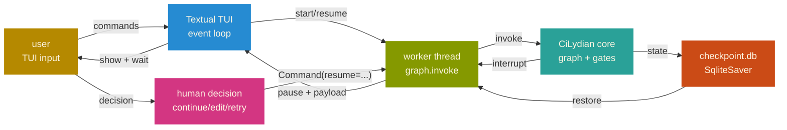
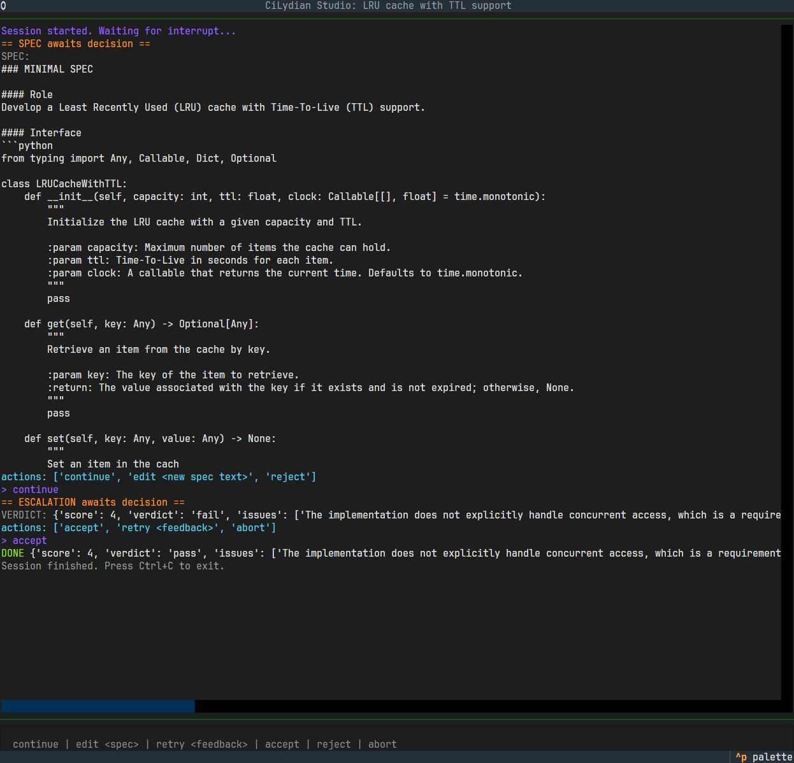

<div align="center">

# cilydian-studio

[](https://python.org)
[](https://langchain-ai.github.io/langgraph/)
[](https://textual.textualize.io/)
[](https://github.com)
[](LICENSE)
[](https://pypi.org/project/cilydian-studio/)
[](https://results.pre-commit.ci/latest/github/sleepti3ht/cilydian-studio/main)
</div>

> Textual TUI client for [CiLydian](https://github.com/sleepti3ht/CiLydian): human-in-the-loop agentic CI pipeline with checkpoint-based resume.

---

## Why cilydian-studio?

CiLydian's CLI runs headless — useful for CI/CD hooks, but opaque when debugging why a run escalated or inspecting generated specs mid-flight. Studio surfaces the graph's internal state: pause at decision points, edit specs on the fly, resume after Ctrl+C without losing token budget.

Compared to LangChain Studio or LangSmith: those are cloud-hosted observability platforms. Studio is a **local-first TUI** — zero telemetry, checkpoint persistence in SQLite, no account required.

---

## Quick Start

```bash
# Install from PyPI
pip install cilydian-studio

# Copy CiLydian config to your working directory
# (or specify --config path explicitly)
cp path/to/cilydian/config.toml .
cp path/to/cilydian/.env .  # if using cloud providers

# Run with a task description
cilydian-studio "Sliding-window rate limiter: max 5 requests per 10s window"
```

**First run:** Studio generates a SPEC, pauses, and waits for your decision. Type `continue` to proceed, `edit <new spec>` to replace it, or `reject` to regenerate.

---

## Commands

| Command | Context | Action |
|---|---|---|
| `continue` | Any interrupt | Proceed to next stage |
| `edit <text>` | SPEC pause | Replace spec with `<text>` |
| `reject` | SPEC pause | Discard spec, regenerate |
| `accept` | Escalation only | Accept failing gates, exit with pass |
| `retry <feedback>` | Escalation only | Send feedback to coder, retry |
| `abort` | Escalation only | Stop execution, exit with fail |

**Escalation** occurs when the bounded repair loop (`MAX_ITER`) is exhausted and gates still fail. Studio surfaces the final verdict and lets you decide: accept (override), retry (with human feedback), or abort.

---

## Features

### Human-in-the-loop
- **Interrupt at SPEC**: review generated spec before coder sees it; edit or reject if the idea was misunderstood
- **Interrupt at escalation**: when the repair loop exhausts, decide whether to accept failing gates or retry with feedback
- **Checkpoint persistence**: SqliteSaver checkpoints enable resume after Ctrl+C; same `--run-id` restores state
- **Live log streaming**: rich-formatted logs from spec/coder/judge/tester stages

### Resume from checkpoint
- **Killed on pause**: re-surface the same interrupt, wait for decision again
- **Killed between stages**: continue from last checkpoint, no re-run of completed steps
- **Already finished**: detect completion, exit cleanly

### Config-driven
- **Inherits CiLydian config**: same `config.toml` and `.env` as CLI
- **HITL auto-enable**: Studio forces `hitl=true` regardless of config setting
- **Run isolation**: each `--run-id` gets its own artifact directory (`runs/<run-id>/`)

---

## Design notes

**Textual TUI over web dashboard.** Studio is a debugging companion, not a collaboration platform. Textual gives us terminal-native rendering, zero network dependencies, and checkpoint persistence without a backend. Web dashboards (LangSmith, Arize) require accounts and cloud egress — antithetical to local-first.

**Checkpoint resume is conservative.** LangGraph's `SqliteSaver` persists state after every node execution. Studio resumes from the last checkpoint, not from scratch. This saves token budget on interrupted runs, but means **state is eventually consistent**: if you edit `config.toml` between runs, the resumed graph uses the old config baked into the checkpoint.

**Interrupt points are minimal.** Only two: after spec generation (before coder sees it) and at escalation (after bounded loop exhausts). More interrupts (e.g., after judge, after tester) would fragment the flow without proportional value — the judge is advisory, and tester failures loop back automatically.

**Studio is a thin client.** All orchestration logic (graph, gates, memory, instincts) lives in `cilydian` core. Studio wraps `build_app(checkpointer=...)` and manages the TUI event loop. This means Studio can be replaced with a web UI or CLI wrapper without touching core logic.

---

## Architecture



**Thread model:**
- **Main thread**: Textual event loop, polls `events` queue, renders logs
- **Worker thread**: runs `graph.invoke`, catches `GraphInterrupt`, puts events in queue, blocks on `commands.get()`
- **Checkpoint writer**: SqliteSaver in WAL mode, single writer (worker), no race conditions

---

## Configuration

Studio inherits CiLydian's config. Copy `config.toml` and `.env` to your working directory:

```toml
# config.toml (from CiLydian repo)
[pipeline]
max_iter = 3
judge_blocking = false
hitl = false   # Studio overrides to true
preflight_llm = true

[roles.spec]
provider = "ollama"
model = "qwen2.5-coder:7b"
temperature = 0.0

[roles.coder]
provider = "ollama"
model = "qwen2.5-coder:7b"
temperature = 0.2

[roles.judge]
provider = "ollama"
model = "qwen2.5:14b"
temperature = 0.0
```

**Cloud profile** (same as CiLydian):

```toml
[roles.judge]
provider = "openai_compat"
base_url = "https://api.groq.com/openai/v1"
model = "openai/gpt-oss-120b"
api_key_env = "GROQ_API_KEY"
```

```bash
# .env
GROQ_API_KEY=your_key_here
```

> ⚠️ Never commit `.env` — keep secrets private.

---

## Companion: CiLydian

**CiLydian** is the headless CLI pipeline. Install from PyPI:

```bash
pip install cilydian
```

**Usage:**

```bash
cilydian run "Your task description"
cilydian export-eval  # dump verdict memory as promptfoo tests
cilydian instincts show  # inspect learned lessons
```

**Source:** [github.com/sleepti3ht/CiLydian](https://github.com/sleepti3ht/CiLydian) | [PyPI](https://pypi.org/project/cilydian/)

---

## Honest Limitations

cilydian-studio is an exploration of agentic workflows — a project driven by curiosity about human-in-the-loop orchestration, checkpoint-based resume, and the boundaries of local LLMs in interactive debugging, rather than a daily-driver replacement for IDEs or cloud-hosted observability platforms. For high-stakes production, pair it with manual multi-vendor workflows (DeepSeek for prompting, Claude for architecture, local ruff/pytest for gates).

**Known constraints:**
- **Checkpoint consistency**: resuming from checkpoint uses the config baked into the state, not the current `config.toml`. Edit config → start new run, don't resume.
- **Single-run focus**: Studio manages one run at a time. No session browser, no history UI (yet).
- **Textual rendering**: long specs/verdicts truncate at 1000 chars in TUI. For full text, inspect `runs/<run-id>/SPEC.md` or logs.

---

## Screenshot



---

## Roadmap

- [x] **Interrupt at spec and escalation** — continue/edit/reject + accept/retry/abort (v0.1.x)
- [x] **Checkpoint resume** — restore state after Ctrl+C (v0.1.x)
- [x] **Live log streaming** — rich-formatted logs from all stages (v0.1.x)
- [ ] **Session browser** — list past runs, inspect artifacts, re-run with same config
- [ ] **Spec editor widget** — Textual TextArea for multi-line spec editing (vs single-line `edit <text>`)
- [ ] **Verdict diff** — show changes between iterations (code_hash comparison)

---

## Contributing

Contributions are welcome! Please open an issue or submit a PR.

### Development setup

```bash
git clone https://github.com/sleepti3ht/cilydian-studio.git
cd cilydian-studio

# Unix / macOS
python -m venv .venv && source .venv/bin/activate
# Windows (PowerShell)
python -m venv .venv; .\.venv\Scripts\Activate.ps1

pip install -e .
pip install pre-commit
pre-commit install

# Run on a sample task
cilydian-studio "LRU cache with TTL"
```

### Code style

- Commit messages: Conventional Commits (`feat(studio): ...`, `fix(tui): ...`)
- Run `ruff check` before pushing (enforced by pre-commit)

---

## License

MIT
